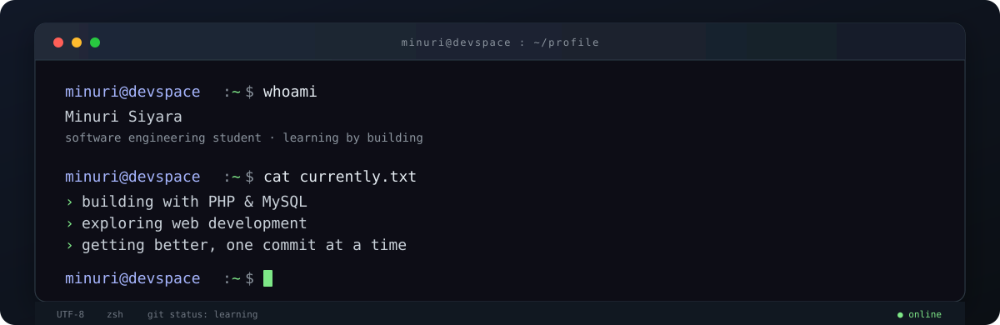

 

**software engineering student · curious mind · always building**

---

### `$ whoami`

Hey, I'm **Minuri Siyara** — a Software Engineering student who enjoys understanding how things work and turning ideas into useful software.

I'm especially interested in backend development, databases, and building clean web experiences. Most days you'll find me learning something new, working through a bug, or figuring out a better way to build something.

### `$ currently`

- Building backend and moderation workflows for **NSBM NewsDesk**.
- Deepening my knowledge of **PHP, MySQL, and database-driven applications**.
- Practising **Java, object-oriented programming, and problem solving**.
- Exploring modern web development one project at a time.

### `$ tech --stack`

  

### `$ ls ./projects`

| Project | What it is |
| --- | --- |
| **NSBM NewsDesk** | A campus news management system with article submissions, review and moderation workflows. I'm working on the backend and moderator features. *(Team project; repository is private.)* |
| **Kathaa AI** | An academic project concept exploring assistive communication through speech-to-text, text-to-speech, AI suggestions and sign-language support. |

### `$ git stats`

 

### `$ contribution --snake`

---

`less noise, more building.`

*Thanks for stopping by. Have a good one!*

